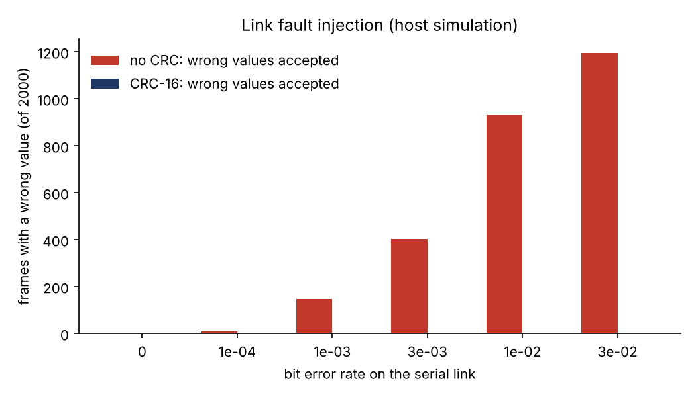
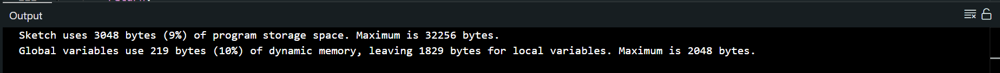

# Rail Monitor

Power rail telemetry on an Arduino Uno, written in C, with a Python ground station. It samples a supply rail, flags under-voltage, over-voltage and over-current, and sends framed, CRC-protected packets over UART.

I built it to get hands-on with the embedded side of spacecraft-style power systems: fixed-rate sampling, serial protocols with error detection, and surviving bit flips. It follows on from my [spacecraft buck converter project](https://github.com/Lakshan-D/spacecraft-buck-converter), where the control loop state is protected with triple modular redundancy. Here the same 2-of-3 voting idea protects the stored limits, and a CRC protects the link.

This is a learning project on hobby hardware. It is inspired by spacecraft telemetry practice. It is not flight hardware and it makes no radiation claims.

## What it does

| Block | How |
|---|---|
| Sampling | Timer1 interrupt at 100 Hz sets a tick, the main loop does the work. No `delay()`. |
| Measurement | ADC on A0 through a resistor divider, 8x oversampled. Optional INA219 (I2C) for current. |
| Fault flags | Under-voltage, over-voltage, over-current. Debounced: N samples in a row to set, N to clear. |
| Link | 14 byte frames at 10 Hz: sync, length, sequence, payload, CRC-16/CCITT-FALSE. |
| Stored limits | EEPROM, 3 copies, bitwise 2-of-3 vote on load, rewritten (scrubbed) when a copy disagrees, re-checked every 60 s. |
| Watchdog | 2 s hardware watchdog. A hung main loop resets the board. |
| Ground station | Python parser with resync after bad frames, CSV log, plot, demo and replay modes. |

Frame layout is in [docs/frame_format.md](docs/frame_format.md).

## Status

| Item | State |
|---|---|
| C core (CRC, framing, voting, fault debounce) | Unit tested on a PC, 478 checks pass |
| C and Python agree on the exact frame bytes | Tested |
| Link fault injection | Done in simulation on the PC, results below |
| Arduino sketch | Compiles for Arduino Uno in Arduino IDE 2.3.10: 3048 bytes flash (9%), 219 bytes RAM (10%). **Not yet run on a real board** |
| INA219 current sensing | Code written from the datasheet. **Untested** |
| RS-485 | Not done, see next steps |

Update this table as you test on hardware.

## Quick start

No hardware needed for the first two:

```bash
bash run_tests.sh                                  # C unit tests, then Python tests
python3 ground/inject_faults.py                 # link fault injection sweep
python3 ground/monitor.py --demo --plot         # ground station on synthetic data
```

With an Uno:

1. Open `firmware/rail_monitor/rail_monitor.ino` in the Arduino IDE and upload.
2. Wire a rail to A0 through a divider (below).
3. `pip install pyserial matplotlib`
4. `python3 ground/monitor.py --port /dev/ttyACM0 --plot` (Windows: `--port COM3`)

While the monitor runs, type `x` then Enter to flip a bit in one EEPROM config copy (watch the `CFG_FIXED` flag appear as the vote repairs it). Type `h` then Enter to hang the board on purpose (watch it reset about 2 s later, the timestamp jumps back to zero).

### Wiring

```
rail (0..10 V) --[ 10k ]--+--[ 10k ]-- GND
                          |
                          +-- A0
```

Two equal resistors give a ratio of 2, so 5 V on the rail is 2.5 V at the pin. Never put more than 10 V on the rail input. Measure the Uno 5 V pin with a multimeter and set `VREF_MV` in the sketch to the real value. For current, wire an INA219 on SDA/SCL and set `USE_INA219` to 1.

Default limits: UV below 4.5 V, OV above 5.5 V, OC above 3 A, debounce 5 samples (50 ms).

## Results

### Link fault injection (host simulation)

2000 frames (28000 bytes) with random bit flips at a given bit error rate. Two receivers see the same damaged stream: one that ignores the CRC, one that checks it. Seed 1, reproduce with `python3 ground/inject_faults.py`.

| Bit error rate | Bits flipped | No CRC: wrong values accepted | CRC-16: wrong values accepted | CRC-16: frames rejected | CRC-16: frames lost |
|---|---|---|---|---|---|
| 0 | 0 | 0 | 0 | 0 | 0 |
| 1e-4 | 17 | 10 | 0 | 14 | 17 |
| 1e-3 | 230 | 148 | 0 | 198 | 217 |
| 3e-3 | 655 | 403 | 0 | 512 | 558 |
| 1e-2 | 2269 | 931 | 0 | 1191 | 1373 |
| 3e-2 | 6810 | 1194 | 0 | 1393 | 1930 |



What this shows: without a CRC, corrupted frames are accepted and they carry wrong rail readings. With the CRC they are dropped, so the ground station loses a sample but never trusts a wrong one. "Lost" is higher than "rejected" because a flipped length byte can swallow neighbouring bytes before the parser resyncs.

What it does not show: a CRC-16 detects every single-bit error (checked exhaustively in the tests) and most multi-bit errors, but not all. For heavily corrupted data roughly 1 in 65,000 bad frames can still pass. Zero wrong frames in this run is not proof that none can get through.

### Demo plot

`results/demo_telemetry.png` is made from **synthetic** data (`--demo`), not from the board. It only shows what the ground station output looks like.

### Compile check



### Bench results

Add yours here after testing on the board: a photo of the setup, a screenshot of the monitor, and what happened when you pulled the rail below 4.5 V, fed it 9 V through the divider, pressed `x`, and pressed `h`.

## Design notes

- **Bitwise CRC, no lookup table.** An ATmega328P has 2 KB of RAM. At 10 frames per second the bitwise version costs nothing noticeable.
- **Big endian on the wire**, so a hex dump reads left to right.
- **Parser resync.** On a CRC failure the parser drops only the sync byte it locked onto and rescans, so one bad frame costs one frame, not the stream.
- **Debounce both ways.** A single noisy ADC sample cannot raise or clear a fault.
- **Voting limits.** 2-of-3 corrects any single flipped bit across the three config copies. If the same bit flips in two copies before a scrub, the vote is wrong. Scrubbing every minute keeps that window small. It cannot help if the whole EEPROM is lost, in which case the firmware falls back to defaults.
- **Portable core.** CRC, framing, voting and fault logic have no Arduino dependencies, so they are tested on a PC with plain `gcc`.

## Known limitations

- Reset cause: the Uno bootloader can clear `MCUSR` before the sketch reads it, so the `WDT_RESET` flag may not set. The ground station also detects resets by the timestamp going backwards.
- The ADC is 10 bit and referenced to the 5 V supply, so absolute accuracy is limited by that supply. Calibrate `VREF_MV`.
- The `x` command is a stand-in for a bit flip, not real radiation.
- A single board, one rail, no isolation. Not suitable for anything safety related.

## Next steps

- Move the link to RS-485 with a MAX485 transceiver and test over a longer cable.
- Port the frame parser to VHDL or Verilog and run it on a small FPGA, to connect this to the buck converter project.
- Add a real current sense path and compare readings against a bench multimeter.
- Measure timing of the sample loop with a scope or logic analyser.

## Layout

```
firmware/rail_monitor/      Arduino sketch and portable C core (src/)
firmware/tests/             PC unit tests for the C core
ground/                     frame.py, monitor.py, inject_faults.py, tests
docs/frame_format.md        wire format
results/                    fault injection results, demo plot
run_tests.sh                builds and runs every test
```
